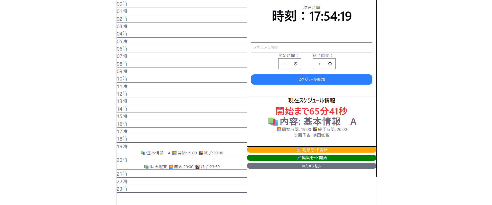
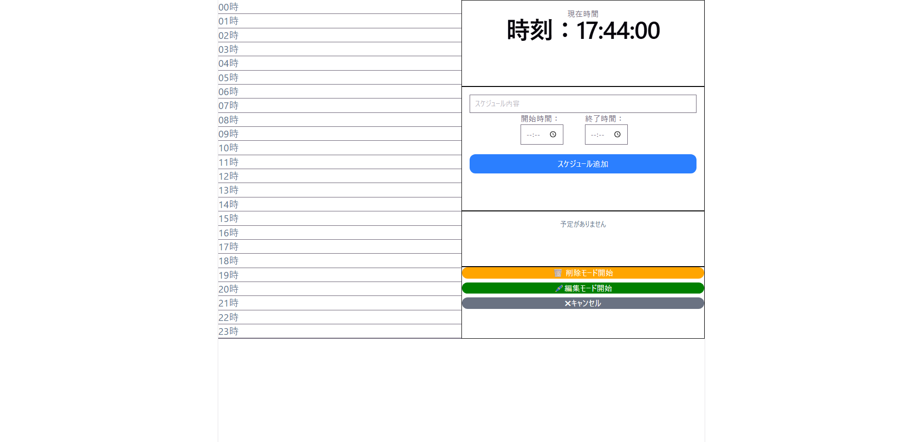

# NextDo

  ## プロジェクト名
  NextDo（プロト版）

  ## プロジェクトの目的
  - Typescriptを使ってみる
  - Laravelとフロントエンドの流れを体験してみる
  - リファクタリングをやってみる
  - 時間管理をする手段が欲しかったため

  ## インストール方法

  ## 使用技術

  ### フロントエンド
  - React (v19) - UIライブラリ
  - TypeScript - 静的型付け言語
  - Vite (v8) - ビルドツール・開発サーバー
  - Tailwind CSS (v4) - ユーティリティファーストのCSSフレームワーク
  - ESLint - 静的コード解析

  ### バックエンド&&データベース
  - PHP (v8.3) - サーバーサイド言語
  - Laravel (v13.x) - PHP Webフレームワーク
  - Laravel Sanctum - API認証（SPA/モバイル用）
  - SQLite - データベース（環境構築不要）

  ## 機能一覧
  - スケジュール内容、開始時間、終了時間の新規登録、編集、削除
  - 開始時間まで、終了時間までの確認、スケジュール内容の確認、次のスケジュール内容の確認
  - スケジュール開始時点、終了時点の通知
      
  ## 使い方

  ## キャプチャー

  

  

  ## Typescriptを学んだ理由、気づき

  - はじめは流行っているからという理由で始めたものであったが、経験していくうちに、jsやReactでもできるけど、Typescriptを使うことで型に関するミスを開発段階で発見しやすくするという将来的な修正や機能使いの際に、データ構造をより人間が把握しやすいものだと感じた。
  - 今回はLaravelとReact間でAPI通信を行っているため、受け取ったデータが想定した構造になっているのかを確認した。APIのレスポンスをunKnownで一旦うけとり、検証するようにした
  - 共通の型定義を用意し、コンポーネント間で再利用できるようにし、API通信とAppの責務を分けることにした。
  - AIに相談することが多く、まだ自分で設計実装したわけではないが、仕組みを理解してパターンを覚えることを目的に行った。
